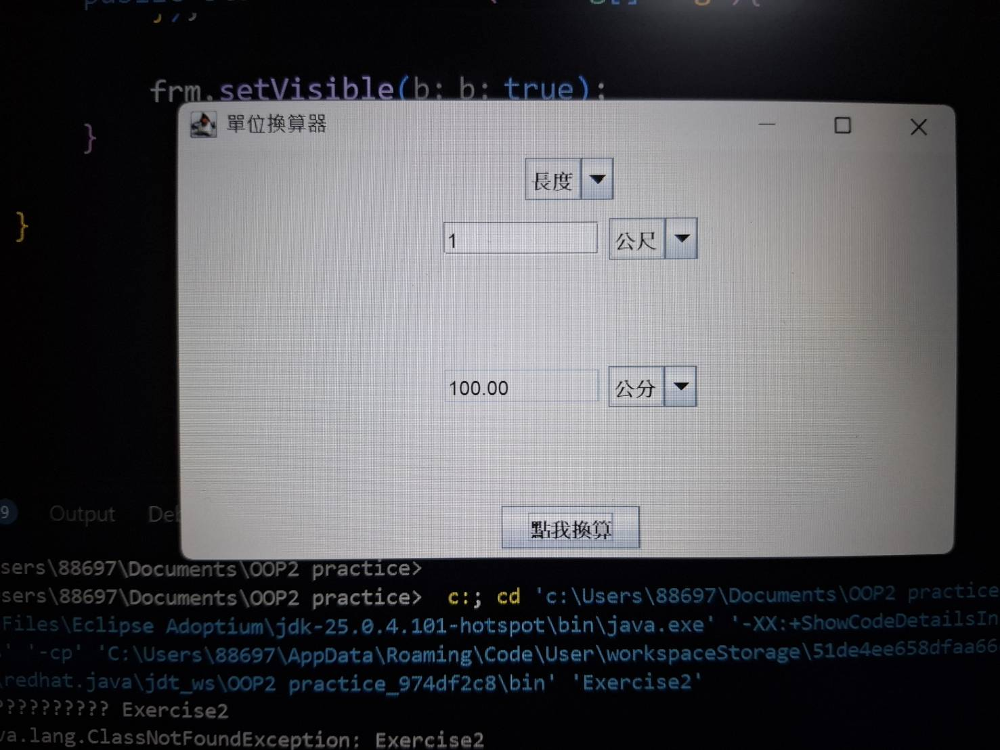
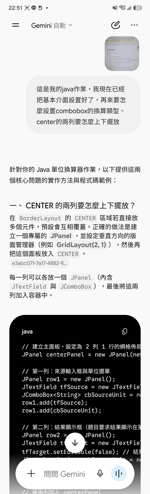
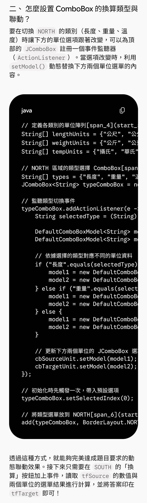
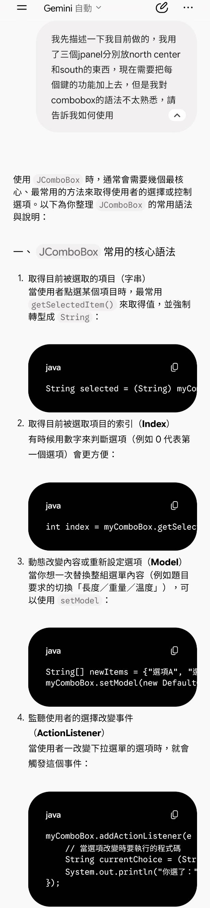
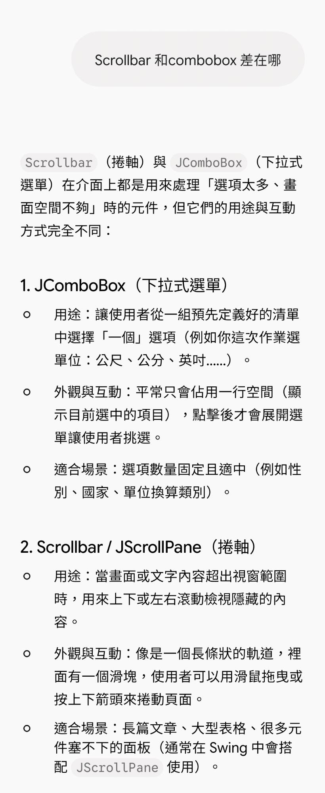
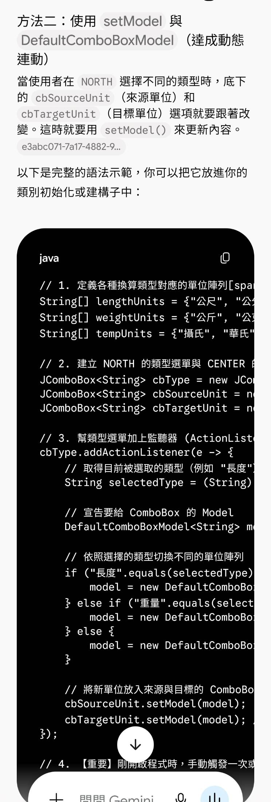
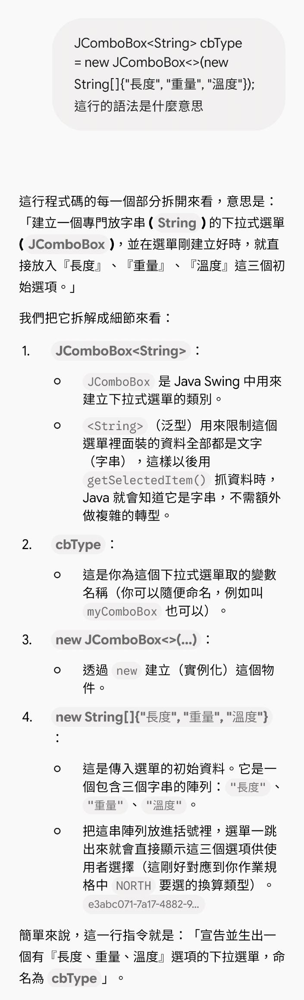
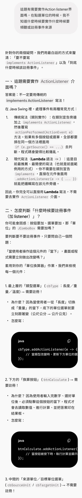
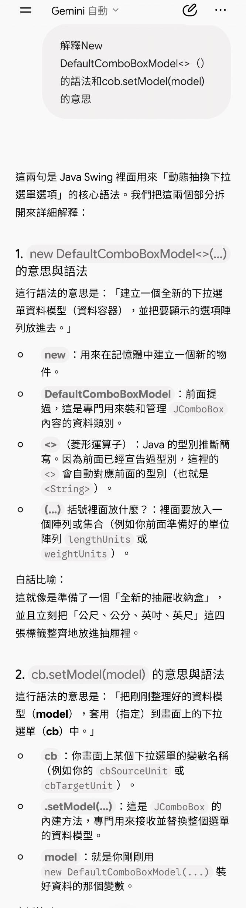
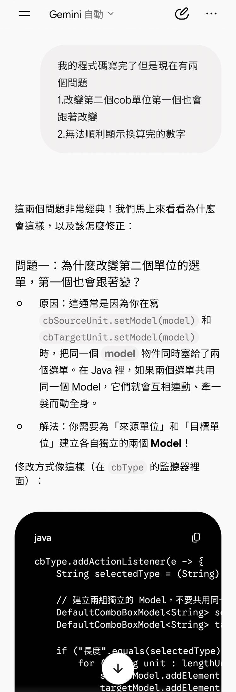

#Java作業:單位換算器
學號:A1143312/姓名:鄭楚瀠

##程式畫面截圖

##與AI對話紀錄

##AI給我的答案還有自己寫的差異
因為這次對Combobox的語法很不熟，所以多問了很多觀念和語法問題。
這次了解到ActionListener不一定要實作介面，也可以用Lambda的方法，主要是語法上要多注意，還有AI讓我發現自己的主程式裡都會寫很多東西，有時候會太雜亂，如果能像它用類別的寫法會更簡潔，也更容易閱讀，下次對語法更熟練可以試試看。